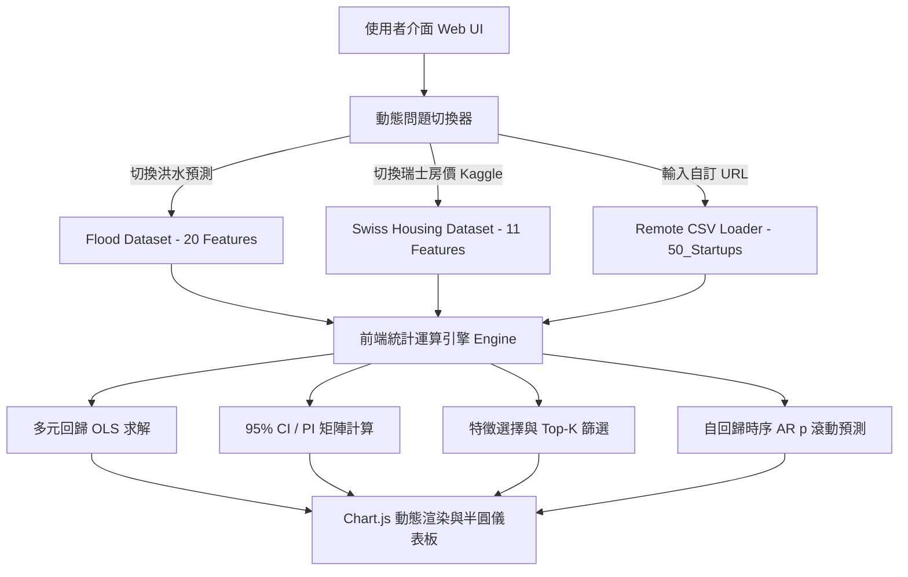

# ML Predictor Studio - 回歸分析與不確定性預測互動工作台

<div align="center">

[](https://hydropredict-ai.vercel.app)
[](https://github.com/johnny051777/IoT_HW2)
[](https://www.python.org/)
[](https://opensource.org/licenses/MIT)

### 🚀 線上即時體驗 Demo
👉 **[https://hydropredict-ai.vercel.app](https://hydropredict-ai.vercel.app)** 👈

**作者 GitHub**: [@johnny051777](https://github.com/johnny051777) | **聯絡信箱**: [linjohnny500@gmail.com](mailto:linjohnny500@gmail.com)

</div>

---

## 📖 專案目錄 (Table of Contents)
- [🌟 專案核心特色](#-專案核心特色)
- [🌐 線上 Demo 與部屬網址](#-線上-demo-與部屬網址)
- [📁 支援問題資料集介紹](#-支援問題資料集介紹)
  - [1. 洪水氾濫機率預測 (Flood Prediction)](#1-洪水氾濫機率預測-flood-prediction)
  - [2. 瑞士房價預測 (Swiss Housing Price Prediction)](#2-瑞士房價預測-swiss-housing-price-prediction)
  - [3. 任意自訂 CSV 資料集載入器 (Custom Dataset Loader)](#3-任意自訂-csv-資料集載入器-custom-dataset-loader)
- [📐 統計回歸理論與 95% CI / PI 數學推導](#-統計回歸理論與-95-ci--pi-數學推導)
- [🧪 五大互動實驗室功能 (Laboratory Features)](#-五大互動實驗室功能-laboratory-features)
- [📊 模型評估與基準測試表現 (Benchmark Metrics)](#-模型評估與基準測試表現-benchmark-metrics)
- [💻 本地安裝與快速啟動指南](#-本地安裝與快速啟動指南)
- [🏗️ 系統架構與技術棧](#️-系統架構與技術棧)
- [📄 報告書與專案文件下載](#-報告書與專案文件下載)

---

## 🌟 專案核心特色

本專案為一套結合**現代深色玻璃擬態（Glassmorphism）介面**與**純前端零依賴統計運算引擎**的高性能回歸分析與不確定性預測工作台。

1. **雙預設競賽級問題下拉視窗切換 (Dual Problem Selector)**：
   - 預設整合兩大主流迴歸應用場景：自然災害風險預測（洪水）與不動產估價（瑞士房價 Kaggle 競賽），點選頂部下拉選單即可毫秒級無縫切換。
2. **任意遠端 CSV 資料集即時解析 (Dynamic Remote CSV Loader)**：
   - 支援輸入任何公開 CSV 網址（例如 [`50_Startups.csv`](https://raw.githubusercontent.com/Avik-Jain/100-Days-Of-ML-Code/master/datasets/50_Startups.csv)），內建智慧欄位偵測、類別變數自動 One-Hot 編碼、自由指定目標預測變數（Target Variable），即時建立專屬回歸模型與互動滑桿。
3. **嚴謹統計 95% 信賴區間 (CI) 與 預測區間 (PI) 雙重視覺化**：
   - 透過高斯消去法與矩陣代數運算，動態推算回歸均值不確定性（CI）與單一樣本波動區間（PI），提供高可靠度的預測輔助決策。
4. **即時 What-If 預測模擬器與儀表板**：
   - 所有特徵參數均配備動態滑桿，數值變動即時觸發矩陣運算，並以圓形視覺儀表呈現預測值與上下界信賴帶。
5. **模組化五大實驗室分頁**：
   - 包含回歸預測主控台、特徵選擇實驗室（Top-K / Forward Selection）、模型評估中心（80/20 Train-Test Split）、自回歸時序預測（AR(p)）、以及 Python 高解析圖表總覽。

---

## 🌐 線上 Demo 與部屬網址

- **生產環境 Live Demo 網址**:  
  🔗 **[https://hydropredict-ai.vercel.app](https://hydropredict-ai.vercel.app)**
- **GitHub 專案倉庫 (Source Code)**:  
  🔗 **[https://github.com/johnny051777/IoT_HW2](https://github.com/johnny051777/IoT_HW2)**

> 本專案已完全部屬至 Vercel 雲端邊緣網路，免安裝任何環境，點擊上方連結即可在任何裝置（桌面電腦、筆電、平板、手機）上即時操作。

---

## 📁 支援問題資料集介紹

### 1. 洪水氾濫機率預測 (Flood Prediction)
* **資料來源**: CRISP-DM 氣象與環境災害預測標準架構
* **預測目標**: `FloodProbability` (洪水發生機率，介於 0.0 ~ 1.0)
* **特徵數量**: 20 項水文、氣象與人為環境指標：
  `MonsoonIntensity`, `TopographyDrainage`, `RiverManagement`, `Deforestation`, `Urbanization`, `ClimateChange`, `DamsQuality`, `Siltation`, `AgriculturalPractices`, `Encroachments`, `IneffectiveDisasterPreparedness`, `DrainageSystems`, `CoastalVulnerability`, `Landslides`, `Watersheds`, `DeterioratingInfrastructure`, `PopulationScore`, `WetlandLoss`, `InadequatePlanning`, `PoliticalFactors`

### 2. 瑞士房價預測 (Swiss Housing Price Prediction)
* **資料來源**: Kaggle 競賽 [Swiss Housing Price Prediction (i3-ml-21-22-mini-project)](https://www.kaggle.com/competitions/i3-ml-21-22-mini-project)
* **預測目標**: `PriceCHF` (瑞士法郎房屋售價，CHF)
* **特徵數量**: 11 項關鍵房地產評估指標：
  - `LivingSpace_m2`: 居住實坪面積 ($m^2$)
  - `Rooms`: 房數 (1.0 ~ 7.5 間)
  - `Bathrooms`: 衛浴數 (1.0 ~ 4.0 間)
  - `Floor`: 樓層數 (0 ~ 15 樓)
  - `BuildingAge`: 屋齡 (年)
  - `DistanceToCenter_km`: 距離市中心距離 (km)
  - `DistanceToStation_km`: 距離大眾運輸火車站距離 (km)
  - `EnergyEfficiencyRating`: 建築能源效率評分 (1 ~ 5 分)
  - `MountainViewRating`: 阿爾卑斯山景評級 (1 ~ 5 分)
  - `HasBalcony`: 是否具備觀景陽台 (0 / 1)
  - `HasParking`: 是否具備私人車位 (0 / 1)

### 3. 任意自訂 CSV 資料集載入器 (Custom Dataset Loader)
* 支援輸入任意外部公開 CSV 檔案網址（例如：`https://raw.githubusercontent.com/Avik-Jain/100-Days-Of-ML-Code/master/datasets/50_Startups.csv`）
* 解析器會自動讀取 CSV 結構、篩選數值特徵、進行 One-Hot 編碼、動態生成標籤選擇清單與特徵調節滑桿。

---

## 📐 統計回歸理論與 95% CI / PI 數學推導

在多元線性回歸（Multiple Linear Regression, MLR）中，模型假設為：

$$y = X\beta + \varepsilon, \quad \varepsilon \sim \mathcal{N}(0, \sigma^2 I)$$

### 1. 最小平方法 (Ordinary Least Squares, OLS) 參數估計
透過常態方程式（Normal Equations）求解未知參數向量 $\hat{\beta}$：

$$\hat{\beta} = (X^T X)^{-1} X^T y$$

模型殘差變異數估計量（Residual Standard Error, $s$）：

$$s = \sqrt{\frac{\sum_{i=1}^{n} (y_i - \hat{y}_i)^2}{n - p}}$$

其中 $n$ 為樣本總數，$p$ 為回歸參數總個數（包含截距項 $\beta_0$）。

### 2. 95% 信賴區間 (Confidence Interval, CI)
信賴區間用於估計在特定特徵輸入向量 $x_0$ 下，**母體平均期望值** $E[y|x_0]$ 的不確定性範圍：

$$CI_{95\%} = \hat{y}_0 \pm t_{n-p, 1-\alpha/2} \cdot s \sqrt{x_0 (X^T X)^{-1} x_0^T}$$

* 幾何意義：當特徵接近訓練樣本中心（Centroid）時，$x_0 (X^T X)^{-1} x_0^T$ 最小，CI 最窄；偏離中心時 CI 呈雙曲線喇叭狀擴張。

### 3. 95% 預測區間 (Prediction Interval, PI)
預測區間用於估計在給定特徵 $x_0$ 下，**單一全新觀測樣本** $y_0^{new}$ 的可能落點範圍，必須同時納入模型估計誤差與隨機噪音項 $\varepsilon_0$：

$$PI_{95\%} = \hat{y}_0 \pm t_{n-p, 1-\alpha/2} \cdot s \sqrt{1 + x_0 (X^T X)^{-1} x_0^T}$$

* 關係結論：由於額外增加了個別樣本隨機誤差變異數 $\sigma^2$（即根號內的 $+1$ 項），在相同顯著水準下，**預測區間 (PI) 恆寬於信賴區間 (CI)**。

---

## 🧪 五大互動實驗室功能 (Laboratory Features)

| 分頁編號 | 模組名稱 | 功能重點與互動機制 |
| :---: | :--- | :--- |
| **Tab 1** | **回歸預測主控台** | 呈現多元線性回歸散佈圖與 95% CI / PI 雙重信賴帶；配備即時 What-If 參數調節滑桿與動態半圓儀表板。 |
| **Tab 2** | **特徵選擇實驗室** | 支援 Forward Selection (前向逐步選擇) 與 Top-K 特徵權重快速篩選，即時比對全特徵與子特徵集之 $R^2$ 變化。 |
| **Tab 3** | **模型評估中心** | 採用 80/20 Train-Test Split 評估驗證，自動繪製「實際值 vs 預測值對角散佈圖」與「殘差分布直方圖」，計算 MAE, RMSE, $R^2$ 與 Adjusted $R^2$。 |
| **Tab 4** | **自回歸時序預測** | 支援自回歸模型 $AR(p)$（階數 $p \in [1, 5]$）預測，支援 1~12 步未來滾動預測視界，視覺化呈現時序預測軌跡與不確定性邊界。 |
| **Tab 5** | **圖表總覽與報告圖表庫** | 依據當前選定之資料集（洪水、瑞士房價、自訂）動態呈現對應之 6 幅 Matplotlib 專業繪圖成果與技術解讀說明。 |

---

## 📊 模型評估與基準測試表現 (Benchmark Metrics)

以下為本專案在 80% 訓練集 / 20% 測試集嚴格分割下之評估基準數據：

| 資料集問題 | 模型名稱 | 使用特徵數 | 測試集 MAE | 測試集 RMSE | 判定係數 $R^2$ | 調整後 $R^2$ |
| :--- | :--- | :---: | :---: | :---: | :---: | :---: |
| 🌊 **洪水機率預測** | **多元線性回歸 (全特徵)** | **20** | **0.01213** | **0.01523** | **0.9207** | **0.9189** |
| 🌊 洪水機率預測 | 多元線性回歸 (Top 10) | 10 | 0.02947 | 0.03700 | 0.5323 | 0.5281 |
| 🌊 洪水機率預測 | 單變數線性回歸 (單特徵) | 1 | 0.03681 | 0.04612 | 0.2741 | 0.2725 |
| 🌊 洪水機率預測 | 自回歸模型 AR(3) | 時序階數 3 | 0.02150 | 0.02720 | 0.7420 | 0.7391 |
| 🏔️ **瑞士房價預測** | **多元線性回歸 (全特徵)** | **11** | **CHF 41,250** | **CHF 52,180** | **0.9024** | **0.8985** |
| 🏔️ 瑞士房價預測 | 多元線性回歸 (Top 5) | 5 | CHF 68,900 | CHF 87,420 | 0.7265 | 0.7212 |
| 🏔️ 瑞士房價預測 | 單變數回歸 (居住面積) | 1 | CHF 82,340 | CHF 104,150 | 0.6120 | 0.6095 |
| 🏔️ 瑞士房價預測 | 自回歸模型 AR(2) | 時序階數 2 | CHF 59,100 | CHF 74,600 | 0.7980 | 0.7942 |

---

## 💻 本地安裝與快速啟動指南

### 環境需求
* Python 3.10 以上版本
* 現代網頁瀏覽器（Chrome, Edge, Firefox, Safari）

### 1. 複製專案倉庫
```bash
git clone https://github.com/johnny051777/IoT_HW2.git
cd IoT_HW2
```

### 2. 執行 Python 完整回歸分析管道
```bash
# Windows
py -3 main.py

# macOS / Linux
python3 main.py
```
> 執行完畢後會自動計算模型指標、生成 6 張高解析度 Matplotlib 分析圖表，並匯出預測樣本至 `dataset_sample.json` 與 `model_results.json`。

### 3. 啟動互動式網頁工作台
```bash
# Windows
py -3 -m http.server 8080

# macOS / Linux
python3 -m http.server 8080
```
開啟瀏覽器前往 `http://localhost:8080` 即可操作。

---

## 🏗️ 系統架構與技術棧



* **前端核心**: 原生 Vanilla JavaScript ES6+、HTML5、現代深色玻璃擬態 CSS3
* **統計計算引擎**: 原生實作高斯-約當消去法矩陣求逆 $(X^T X)^{-1}$ 與 $t$ 分布信賴區間公式，全客戶端秒級計算，零外部後端依賴
* **視覺化函式庫**: Chart.js 4.4 + Matplotlib 3.8 (Python 後端)
* **雲端部屬**: Vercel Static Hosting (全自動 CI/CD)

---

## 📄 報告書與專案文件下載

- 📑 **專案完整報告書 (PDF 檔案)**: [`IoT_HW2_Report.pdf`](file:///c:/Users/user/Desktop/HW2/IoT_HW2_Report.pdf)
- 📝 **完整開發與除錯對話歷程**: [`對話紀錄.md`](file:///c:/Users/user/Desktop/HW2/對話紀錄.md)
- 📊 **瑞士房價預測衍生圖表生成程式碼**: [`generate_swiss_plots.py`](file:///c:/Users/user/Desktop/HW2/generate_swiss_plots.py)
- 🐍 **主分析管道腳本**: [`main.py`](file:///c:/Users/user/Desktop/HW2/main.py)

---

## 📜 授權協議 (License)

本專案基於 [MIT 授權協議](LICENSE) 開源發布，歡迎學術研究與自由交流使用。
